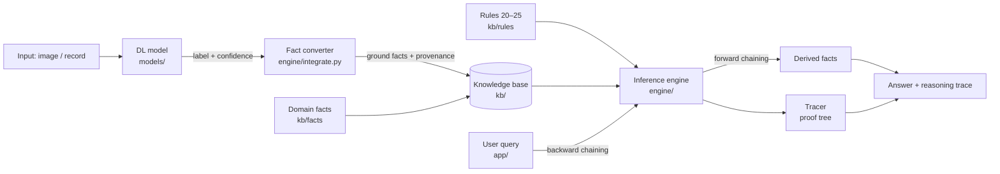

# ARCHITECTURE — pipeline, modules, engine design

Stack: **Python 3.11+** throughout. DL side: **PyTorch + torchvision**
(fine-tuning a pretrained CNN) — the team's known stack from PAI; scikit-learn
allowed for a tabular baseline. KRR side: **hand-written Python, no rule-engine
library** (see DECISIONS ADR-003). Interface: CLI. No server, no database —
the KB is code + data files, loaded at startup.

## Data flow

## Module map (planned file layout)
| Path | Contents | Owner (proposal) |
|---|---|---|
| `models/dataset.py` | dataset download/load, splits, transforms | Abdul Wahid |
| `models/train.py` | fine-tuning loop, checkpoints, metrics | Abdul Wahid |
| `models/predict.py` | inference wrapper: input → (label, confidence, top-k) | Abdul Wahid |
| `kb/facts.py` | domain fact base (data, grouped + commented) | Faseeh |
| `kb/rules.py` | the 20–25 rules as data (head, body, name, comment) | Faseeh |
| `kb/vocabulary.py` | predicate registry — must match DATA_MODEL.md table | Faseeh |
| `engine/terms.py` | `Var`, `Atom`, `Compound` (functor+args), substitution type | Daniyal |
| `engine/unify.py` | `unify(t1, t2, subst)` with occurs check | Daniyal |
| `engine/kb.py` | FactBase (indexed by functor/arity) + RuleBase | Daniyal |
| `engine/forward.py` | forward chaining to fixpoint; logs every firing | Daniyal |
| `engine/backward.py` | SLD-style goal solver (generator), depth cap, proof tree | Daniyal |
| `engine/tracer.py` | proof tree / derivation log → readable indented text | Daniyal |
| `engine/integrate.py` | DL output → symbolic facts (threshold policy, provenance) | Abdul Wahid |
| `app/main.py` | CLI menu, the 5+ demo queries, session loop | Daniyal |
| `tests/` | pytest suites (TESTING.md) | all |
| `paper/` | paper PDF, reference, DOI/IF evidence, reading notes | all |

## Engine design (the 20-marks core — build it like it matters)
- **Terms:** atoms are strings/numbers; variables are `Var("X")`; compound
  terms are `Compound(functor, args)`. A *fact* is a ground compound.
  A *rule* is `head :- body` where body is a list of goals; built-in goals:
  comparisons (`lt`, `gte`, …), `not_provable(goal)` for negation-as-failure,
  and `exception(...)` markers for conflict rules.
- **Unification:** Robinson unification with occurs check; returns a
  substitution (dict Var→term) or failure. Substitutions compose and are
  applied when instantiating rule heads — fresh variable renaming per rule
  use (standardising apart) is mandatory.
- **Forward chaining:** start from the fact base (domain facts + DL facts),
  repeatedly fire every rule whose body is satisfied under some substitution,
  add head instances, stop at fixpoint. Every firing is logged
  (rule name + bindings + new fact) — this log *is* the forward trace.
- **Backward chaining:** given a goal, find rules whose head unifies with it,
  solve body goals left-to-right recursively, yield each solution
  substitution; record the proof tree (goal → rule used → sub-proofs → facts
  matched). Depth cap (e.g. 25) prevents loops; a `visited` guard handles
  left-recursive shapes.
- **Negation as failure:** `not_provable(G)` succeeds iff backward chaining
  finds no proof of `G` (closed-world assumption — documented per rule in
  DATA_MODEL.md, as the course expects).
- **Conflict / exception handling:** rules may declare an exception pattern
  (e.g. `avoid(D,U,allergy)` beats `recommended(D,U)`). Resolution is
  explicit, not accidental: when both a conclusion and its exception are
  derivable, the exception wins and the tracer prints a `CONFLICT` node
  showing both derivations and the deciding rule. This is a designed test
  case (TESTING.md T-07), not a bug path.
- **Provenance:** every fact carries metadata `(source, confidence)` —
  source ∈ {kb, dl_model, derived(rule_name)}. DL facts below the confidence
  threshold (default 0.60, tune in Phase 5) are stored but flagged
  `uncertain` and cannot alone fire recommendation rules.

## DL side conventions
- Fine-tune, don't train from scratch: pretrained torchvision weights,
  freeze early layers, train the head (+ last block) — reproducible on Colab.
- Fixed seed; train/val/test split recorded in `models/README` notes;
  report accuracy + confusion matrix honestly in the final report.
- `predict.py` is the ONLY module the engine side imports from `models/` —
  the integration boundary stays one function wide:
  `predict(input) -> list[(label, confidence)]`.

## Code conventions
- Type hints everywhere; dataclasses for terms; no global mutable state
  outside the KB objects.
- Every rule in `kb/rules.py` carries: name, one-line comment of meaning,
  and the DATA_MODEL.md rule-plan ID (R-01…) — code and brain never drift.
- Errors: engine raises typed exceptions (`UnificationError` is internal;
  user-facing failures are *answers*: "cannot be derived", never tracebacks).
